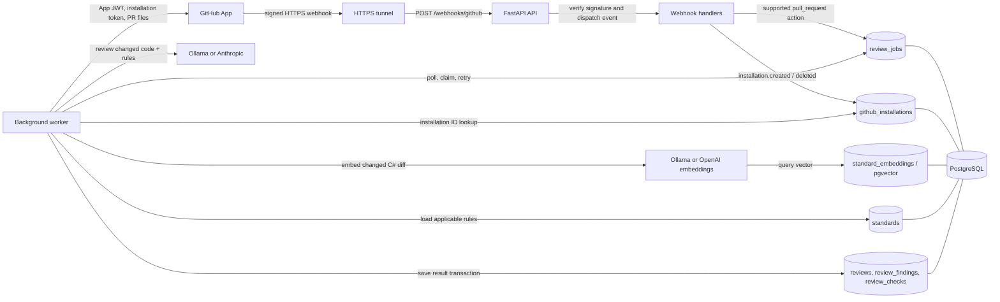

# AI Code Review Assistant

A Python backend that receives GitHub pull-request webhooks, queues review jobs,
retrieves relevant organization standards, and analyzes changed C# code using
Anthropic or a local Ollama model. Review jobs and findings are stored in
PostgreSQL with pgvector.

> **Project status:** Development prototype. The backend stores review findings
> but does not yet publish review comments to GitHub. It currently accepts
> organization-owned repositories and analyzes changed `.cs` files.

## What it does and why

The assistant automates an initial, standards-aware review of pull requests.
It fetches changed files from GitHub, checks changed C# code against relevant
organization standards, and stores the result for later inspection.

The API and worker are separate processes so GitHub can receive a quick webhook
acknowledgment while the slower GitHub API and model calls happen in the
background. PostgreSQL is the shared hand-off point: it makes queued work
durable, supports retries, and stores review output. Ollama can keep model
inference local; alternatively, the review and embedding providers can be
configured to use hosted APIs.

The app currently stores findings; it does not publish review comments to
GitHub. It accepts organization-owned repositories and analyzes changed `.cs`
files.

## Architecture and communication



### End-to-end pull request flow

```mermaid
sequenceDiagram
    participant GH as GitHub
    participant Tunnel as HTTPS tunnel
    participant API as FastAPI API
    participant DB as PostgreSQL
    participant Worker as Review worker
    participant App as GitHub App API
    participant Embed as Embedding provider
    participant LLM as Review model

    GH->>Tunnel: pull_request webhook + signature + delivery ID
    Tunnel->>API: POST /webhooks/github
    API->>API: Verify HMAC signature and parse event
    API->>DB: Insert/deduplicate review_jobs row
    DB-->>API: Commit job
    API-->>GH: HTTP 200 {"status":"accepted"}

    Worker->>DB: Poll and claim pending job
    Worker->>DB: Read github_installations by organization
    DB-->>Worker: GitHub App installation ID
    Worker->>App: Sign App JWT; request installation token
    App-->>Worker: Installation access token
    Worker->>App: Fetch PR and changed files
    App-->>Worker: PR revision and file patches
    Worker->>Embed: Embed C# diff context
    Embed-->>Worker: Query vector
    Worker->>DB: Load mandatory and similar organization standards
    DB-->>Worker: Applicable standards
    Worker->>LLM: Analyze changed C# code against standards
    LLM-->>Worker: Findings and checks
    Worker->>DB: Save review, findings, checks; mark job completed
```

1. **GitHub sends events.** The GitHub App sends signed HTTPS webhooks to
   `/webhooks/github`. For local development, the HTTPS tunnel forwards to the
   API on port `8000`.
2. **The API verifies and dispatches.** It checks `X-Hub-Signature-256` against
   the raw request body, reads `X-GitHub-Event` and `X-GitHub-Delivery`, then
   dispatches installation or pull-request events. A valid but unsupported
   action is acknowledged and ignored.
3. **Installation events prepare GitHub access.** An
   `installation.created` event stores the organization login (lowercase) and
   installation ID. An `installation.deleted` event removes it. The worker
   needs this mapping to obtain an installation token later.
4. **Pull-request events enqueue work.** Actions `opened`, `reopened`,
   `synchronize`, and `ready_for_review` create or reuse a job for that
   repository, PR number, and head revision. The delivery ID and revision
   constraints make webhook retries idempotent. The API returns only after the
   enqueue transaction completes.
5. **The worker reviews asynchronously.** It polls `review_jobs`, claims a
   job with a lease, authenticates as the GitHub App, and downloads the PR and
   changed-file patches. Only C# files are analyzed.
6. **Standards and models are applied.** The embedding provider turns the C#
   diff context into a query vector. The worker loads mandatory standards and
   the most similar indexed standards for the organization. The review
   provider evaluates changed code against those rules.
7. **The result is persisted.** One transaction stores review coverage,
   findings, and checks, then marks the job `completed`. Nothing is posted as
   a GitHub comment.

> **Interpreting webhook responses:** HTTP 200 with
> `{"status":"accepted"}` means the API accepted the request. For a supported
> PR action it means the job was enqueued (or an existing matching job was
> reused); it does not mean analysis completed. A valid unsupported action is
> also acknowledged but does not create a job.

### Processes and responsibilities

| Process/service | Communicates with | Responsibility |
| --- | --- | --- |
| GitHub App | HTTPS tunnel/API; GitHub API | Sends installation and PR webhooks; provides PR data and installation tokens. |
| HTTPS tunnel | GitHub and local API | Exposes local port `8000` through a public HTTPS URL. It is only needed for local live-webhook testing. |
| FastAPI API | GitHub webhook sender and PostgreSQL | Verifies webhooks, records installations, and enqueues supported PR events. It does not call the review model. |
| PostgreSQL with pgvector | API and worker | Shares durable jobs and installation data; stores standards, embeddings, and review results. |
| Review worker | PostgreSQL, GitHub API, embedding provider, review provider | Claims jobs, fetches PR changes, retrieves standards, calls models, and saves results. |
| Embedding provider | Worker | Embeds standards for indexing and changed C# diffs for similarity search. |
| Review provider | Worker | Analyzes changed code and returns findings/checks. |

### Database tables involved

| Table | Written/read by | Purpose and relationship |
| --- | --- | --- |
| `github_installations` | API writes; worker reads | Maps normalized organization login to GitHub App installation ID. Required for worker authentication to GitHub. |
| `review_jobs` | API enqueues; worker claims, retries, and completes | Durable queue and lifecycle state. Stores repository, PR number, revision, delivery ID, attempt count, lease, and last error. Unique delivery/revision constraints prevent duplicate work. |
| `standards` | Standards loader/writer; worker reads | Active organization review rules, including guidance, language, category, enforcement, and severity. |
| `standard_embeddings` | Indexing flow writes; worker reads | pgvector embeddings associated with `standards.id` and embedding model; used for semantic standards retrieval. |
| `reviews` | Worker writes | One review summary per job, including changed-file and analyzed-file counts. References `review_jobs.id`. |
| `review_findings` | Worker writes | Individual findings, including severity, explanation, file path, line range, evidence, and optional standard ID. References `reviews.id`. |
| `review_checks` | Worker writes | Per-check status and summary returned by the analyzer. References `reviews.id`. |
| `alembic_version` | Alembic | Tracks which database migrations have been applied; it is schema bookkeeping, not review data. |

Typical relationship:

```text
github_installations (organization_id)

review_jobs (1) ── (0..1) reviews (1) ── (*) review_findings
                                    └────── (*) review_checks

standards (1) ── (0..1 per embedding model) standard_embeddings
```

`review_jobs.status` progresses through `pending`, `processing`, then
`completed` or `failed`. A processing lease allows recovery if a worker stops
mid-job. On a processing error, the job records `last_error` and may be
scheduled for retry up to the configured attempt limit. The current worker
process lets that error escape after recording it, so restart the worker to
continue processing pending retries.

The code is organized into:

- `backend/src/code_review_assistant/domain/` — core review and standard models.
- `backend/src/code_review_assistant/application/` — review workflow, job processing,
  and service ports.
- `backend/src/code_review_assistant/infrastructure/` — FastAPI webhook, GitHub,
  database, and model adapters.
- `backend/tests/unit/` and `backend/tests/integration/` — automated tests.
- `backend/migrations/versions/` — Alembic database migrations.

## Requirements

- Git and Windows PowerShell (commands below use PowerShell syntax).
- Python 3.12 or later recommended.
- Docker Desktop with Docker Compose.
- Ollama and the models below for local-model review and embedding integration tests.
- A GitHub App, organization, and public HTTPS webhook URL (for live GitHub testing).

The package metadata currently declares Python `>=3.10`; Windows users should use a
recent Python version because async Psycopg requires a Selector event loop.

## Configure environment

Create or update the repository-root `.env` file. Do not commit it or share its
contents.

```dotenv
POSTGRES_DB=review_assistant
POSTGRES_USER=review_assistant
POSTGRES_PASSWORD=replace-with-a-local-password
POSTGRES_HOST=127.0.0.1
POSTGRES_PORT=5432

REVIEW_PROVIDER=ollama
REVIEW_MODEL=llama3.2:latest
EMBEDDING_PROVIDER=ollama
EMBEDDING_MODEL=nomic-embed-text:latest
EMBEDDING_DIMENSIONS=768
OLLAMA_BASE_URL=http://127.0.0.1:11434

GITHUB_APP_ID=your-app-id
GITHUB_PRIVATE_KEY_PATH="C:\path\to\your-app-private-key.pem"
GITHUB_WEBHOOK_ENABLED=true
GITHUB_WEBHOOK_SECRET=the-same-secret-configured-in-github
```

For Anthropic reviews or OpenAI embeddings, select the corresponding provider and
configure its API key. Never put a private key, API token, or real webhook secret in
source control.

## Set up the backend

From the repository root:

```powershell
cd backend
py -3.12 -m venv .venv
.\.venv\Scripts\Activate.ps1
python -m pip install --upgrade pip
python -m pip install -e ".[dev]"
```

Start PostgreSQL from the repository root in another terminal:

```powershell
cd C:\path\to\ai-code-review-assistant
docker compose up -d db
```

Apply migrations from the `backend` directory:

```powershell
.\.venv\Scripts\python.exe -m alembic upgrade head
```

For local Ollama use:

```powershell
ollama pull llama3.2:latest
ollama pull nomic-embed-text:latest
```

## Run locally

Keep PostgreSQL and Ollama running.

Start the API in a terminal from `backend`:

```powershell
.\.venv\Scripts\python.exe -m uvicorn code_review_assistant.main:app --reload --host 127.0.0.1 --port 8000
```

Verify the API:

```text
http://127.0.0.1:8000/health
```

Expected response:

```json
{"status":"ok"}
```

Start the worker in a second terminal from `backend`:

```powershell
.\.venv\Scripts\python.exe -c "import asyncio; from code_review_assistant.worker import run_worker; asyncio.run(run_worker(), loop_factory=asyncio.SelectorEventLoop)"
```

The worker polls the queue and can appear idle when there are no jobs. Keep both
the API and worker running.

## Configure a GitHub App

1. Create a GitHub App owned by the organization that owns the test repository.
2. Configure a webhook URL that GitHub can reach. For local development, expose
   port `8000` through an HTTPS tunnel, then use:
   `https://YOUR-TUNNEL-HOST/webhooks/github`.
3. Configure the same webhook secret in GitHub and the local `.env`.
4. Subscribe to **Installation** and **Pull request** events.
5. Grant the repository permissions needed to read pull requests. Add write
   permission only when review publishing is implemented and required.
6. Generate a private key and set `GITHUB_PRIVATE_KEY_PATH` to the downloaded
   `.pem` file.
7. Install the app on the organization and select the test repository.
8. Restart the API and worker after changing `.env`.

The current webhook handler requires the repository owner type to be
`Organization`. Installing the app on an organization does not transfer a
personal repository into that organization.

## Load organization standards

`backend/demo_standards.json` is sample data and includes a C# rule for avoiding
blocking asynchronous code. `backend/import_demo_standards.py` is a test-data
helper: it imports the sample standards for `demo-org` into the
`review_assistant_test` database only. It does not import standards for your
GitHub organization or create embeddings.

For production reviews, organization standards must be stored in `standards`.
Mandatory standards can be loaded directly; semantic retrieval also requires
matching entries in `standard_embeddings` for the configured embedding model.
The `IndexStandards` application service implements embedding/indexing, but
there is currently no standalone production import/index command or HTTP
endpoint. Consequently, an empty or unindexed standards database can produce a
review with no applicable standards; the review job can still complete.

## Test

Run the normal test suite from `backend`:

```powershell
.\.venv\Scripts\python.exe -m pytest -q
```

PostgreSQL integration tests use the separate `review_assistant_test` database.
Create it if needed:

```powershell
docker compose exec db psql -U review_assistant -d postgres -c "CREATE DATABASE review_assistant_test OWNER review_assistant;"
```

Set `POSTGRES_DB=review_assistant_test` temporarily in the shell and apply
migrations to that database before running database integration tests:

```powershell
$env:POSTGRES_DB = "review_assistant_test"
.\.venv\Scripts\python.exe -m alembic upgrade head
Remove-Item Env:POSTGRES_DB
```

Enable PostgreSQL tests:

```powershell
$env:RUN_DB_INTEGRATION_TESTS = "1"
.\.venv\Scripts\python.exe -m pytest tests\integration -q
```

Enable live Ollama integration tests too. These call the local Ollama server and
may take longer:

```powershell
$env:RUN_OLLAMA_INTEGRATION_TESTS = "1"
.\.venv\Scripts\python.exe -m pytest tests\integration -q
```

The end-to-end Ollama/PostgreSQL pipeline test requires both flags. Remove the
flags when finished if you want subsequent runs to skip those tests:

```powershell
Remove-Item Env:RUN_DB_INTEGRATION_TESTS -ErrorAction SilentlyContinue
Remove-Item Env:RUN_OLLAMA_INTEGRATION_TESTS -ErrorAction SilentlyContinue
```

### Test coverage

The suite includes unit tests for domain validation, webhook verification and
routing, installation and pull-request event handling, GitHub API adapters,
provider adapters, job retries and leases, standards retrieval, and persistence.

Integration tests cover PostgreSQL job queue behavior, review-result persistence,
standard embeddings, GitHub installation lookup, and optional real Ollama calls.

## Verify a live pull-request flow

1. Confirm `/health` responds with `{"status":"ok"}`.
2. Keep PostgreSQL, Ollama, the API, worker, and HTTPS tunnel running.
3. Open a PR in a repository owned by the configured organization.
4. In GitHub App settings, inspect **Advanced → Recent deliveries**.
5. A successful webhook response is HTTP 200 with `{"status":"accepted"}`.
6. Check PostgreSQL for job status and findings:

```sql
SELECT j.organization_id, j.repository_id, j.pull_request_number,
       j.status, j.attempt_count, j.last_error,
       r.changed_files, r.analyzed_files,
       COUNT(f.id) AS finding_count
FROM review_jobs AS j
LEFT JOIN reviews AS r ON r.job_id = j.id
LEFT JOIN review_findings AS f ON f.review_id = r.id
GROUP BY j.id, r.id
ORDER BY j.created_at DESC;
```

A `completed` job means analysis and persistence completed. A `failed` job has an
error in `last_error`; `pending` or `processing` means it is waiting or running.

## Current limitations

- Findings are persisted, but the app does not yet publish review comments to GitHub.
- Only changed C# (`.cs`) files are analyzed.
- Pull requests from repositories not owned by an organization are rejected.
- The demo standards JSON has no implemented import/index command yet.
- Live Ollama tests require locally installed models and can be slower or
  nondeterministic compared with mocked unit tests.